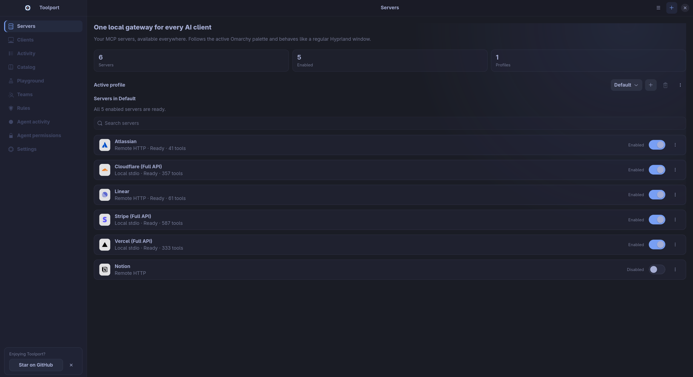

# Toolport

**Set up your MCP servers once. Use them in every AI client.**

Toolport is a local gateway for MCP, the protocol that gives AI apps access to
tools like GitHub, Slack, and databases. Connect your servers once, then share
them across Claude, Cursor, Codex, VS Code, and other clients.

[Download](https://toolport.app/download) · [Website & demo](https://toolport.app) · [Discord](https://discord.gg/Xsn27MxdBA)

## Why Toolport?

- **Less context overhead.** Agents search for tools when they need them instead
  of loading every tool definition up front. It pays off past roughly 10 to 25
  tools, so a single small server sees no gain. See the [benchmarks](BENCHMARK.md).
- **One setup for every client.** Add and authenticate each server once. Use
  profiles to choose which servers each client can access.
- **Keys stay local.** Credentials live in your OS keychain, outside client configs.
- **Control over tool calls.** Disable tools, require approval for destructive
  calls, and review activity in one place.
- **Shared agent rules.** Write instructions once and apply them to supported
  clients, with a preview before changes are written.

## Get started

1. [Download Toolport](https://toolport.app/download) for Windows, macOS, or Linux.
2. Add a server from the catalog, import an existing setup, or paste a server config.
   Curated servers that need launch arguments show a Launch setup section in the app.
3. Authenticate the server, then open **Clients** and connect your AI apps.
   Restart or reload the client once so it picks up Toolport.

Installers and release notes are also on
[GitHub Releases](https://github.com/btsouth/toolport/releases).
On Arch and Omarchy, the [pacman repository](docs/arch-pacman-repo.md) keeps
Toolport on your normal update path.

Working with a team? [Toolport Teams](https://toolport.app/teams) shares server
configuration and policies while each member keeps their own credentials.

## Interface language

Open **Settings → General → Language** to choose English, Japanese, Simplified
or Traditional Chinese, Korean, Spanish, French, German, or Brazilian Portuguese.
Choose **System language** to follow your system language; unsupported languages
fall back to English. Changes apply immediately and preserve unsaved input.
Your choice is saved locally, and translations work without a translation service.

Native tray menus, the separate GTK interface, and raw backend or MCP diagnostics
retain their original wording. If a language dictionary fails to load, the UI
falls back to English and shows an error; reload Toolport to retry.

## Documentation

- [Supported clients and setup](docs/clients.md)
- [Profiles, environment variables, and configuration](docs/configuration.md)
- [Agent rules](docs/agent-rules.md) and [permissions](docs/agent-permissions.md)
- [Headless gateway and Docker](docs/headless.md)
- [Arch and Omarchy install (pacman repository)](docs/arch-pacman-repo.md)
- [Open WebUI](docs/openwebui.md) and [agent plugin](packaging/agent-plugin/toolport/README.md)
- [Security](SECURITY.md) and [troubleshooting](docs/troubleshooting.md)
- [Uninstall](docs/uninstall.md)
- [Changelog](CHANGELOG.md)

## Development

See [Contributing](CONTRIBUTING.md) for building from source and testing,
[DESIGN.md](DESIGN.md) for the system design, and [AGENTS.md](AGENTS.md) for
agent work and verification requirements.

## License

The desktop app and gateway are [MIT licensed](LICENSE).
