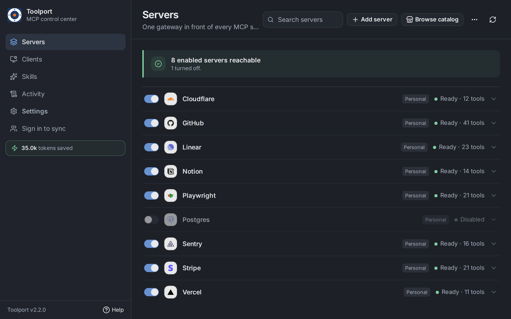

# Toolport

[](https://github.com/btsouth/toolport/actions/workflows/ci.yml)
[](https://github.com/btsouth/toolport/releases)
[](LICENSE)
[](https://discord.gg/Xsn27MxdBA)
[](https://glama.ai/mcp/servers/tsouth89/toolport)

**Your AI agents' tools, skills and rules. Set up once, on every machine.**

Toolport is a free desktop app and local gateway for MCP, the protocol that gives
AI apps tools like GitHub, Linear and databases. Add a server once and Claude Code,
Codex, Cursor, VS Code and 40+ other agents can all use it.

[Download](https://toolport.app/download) · [Website & demo](https://toolport.app) · [Discord](https://discord.gg/Xsn27MxdBA)



## Why Toolport?

- **One setup for every agent.** Toolport finds the agents on your machine, imports
  the servers they already have and gives each one a single Toolport entry. Fix a
  server once and every agent gets the fix. Access sets choose which servers each
  agent can reach.
- **Every machine, too.** [Pro](https://toolport.app/pricing) syncs your servers to
  each computer you sign in on. Secrets stay on each machine.
- **Skills and rules in one place.** See which skills and rules files (`CLAUDE.md`,
  `AGENTS.md` and others) each agent actually loads, turn skills on or off per agent,
  and link agents to the rules file the others already share.
  See [skills and rules](docs/skills-and-rules.md).
- **Safe by default.** API keys move out of plain-text configs into your OS keychain.
  Toolport pins every tool definition and flags changes, such as a tool you approved
  rewriting its description, plus hidden instructions in descriptions and results.
  The default Ask level holds destructive calls for your OK. Strict also quarantines
  changed tools and blocks detected injection. Every call is in Activity. See
  [security](SECURITY.md).
- **Lighter on context where it helps.** For agents that send every tool definition on
  every request, Toolport's search tools can cut input tokens by several times. Claude
  Code, Codex and Cursor already defer tools, so Toolport's Auto mode gives them the
  full list (Claude Code up to 800 tools). See the [benchmarks](BENCHMARK.md).

## Get started

1. [Download Toolport](https://toolport.app/download) for Windows, macOS, or Linux.
2. Add a server from the catalog, import an existing setup, or paste a server config.
   Curated servers that need launch arguments show a Launch setup section in the app.
3. Authenticate the server, then open **Clients** and connect your AI apps.
   Restart or reload the client once so it picks up Toolport.

Installers and release notes are also on
[GitHub Releases](https://github.com/btsouth/toolport/releases).
On Arch and Omarchy, the [pacman repository](docs/arch-pacman-repo.md) keeps
Toolport on your normal update path.

Working with a team? [Toolport Teams](https://toolport.app/teams) shares server
configuration and policies while each member keeps their own credentials.

## Documentation

- [Upgrade from 1.24.x to 2.0](docs/migration.md)
- [Supported clients and setup](docs/clients.md)
- [Skills and rules each agent loads](docs/skills-and-rules.md)
- [Access sets, environment variables, and configuration](docs/configuration.md)
- [Headless gateway and Docker](docs/headless.md)
- [Arch and Omarchy install (pacman repository)](docs/arch-pacman-repo.md)
- [Open WebUI](docs/openwebui.md) and [agent plugin](packaging/agent-plugin/toolport/README.md)
- [Security](SECURITY.md) and [troubleshooting](docs/troubleshooting.md)
- [Uninstall](docs/uninstall.md)
- [Changelog](CHANGELOG.md)

## Development

Requires Node.js and stable Rust, plus the platform dependencies described in
[Contributing](CONTRIBUTING.md).

```sh
npm ci
npm run build:gateway
npm run tauri dev
```

See [Contributing](CONTRIBUTING.md) for testing and build instructions.

## Toolport Teams

Share server configuration and policies across a team while each member keeps
their own credentials. [Hosted and self-hosted options](https://toolport.app/teams).

## License

The desktop app and gateway are [MIT licensed](LICENSE).
