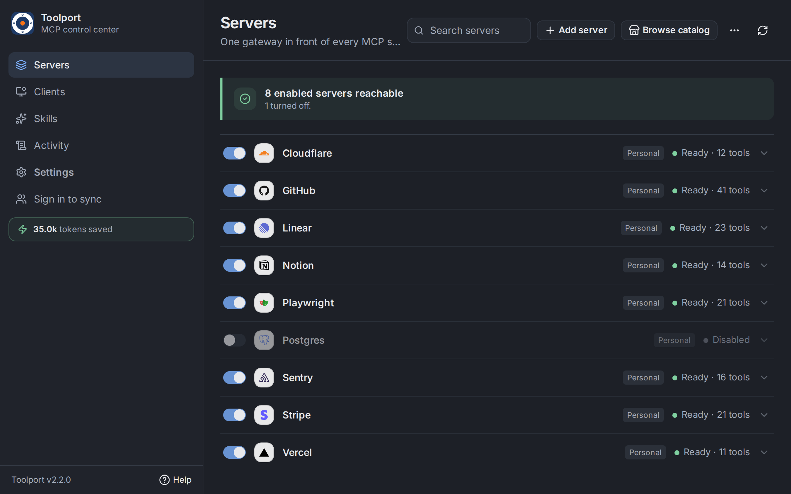

# Toolport

[](https://github.com/btsouth/toolport/actions/workflows/ci.yml)
[](https://github.com/btsouth/toolport/releases)
[](https://www.npmjs.com/package/@toolport/cli)
[](LICENSE)
[](https://discord.gg/Xsn27MxdBA)
[](https://glama.ai/mcp/servers/btsouth/toolport)

**One setup for every coding agent.**

Claude Code, Codex, Cursor, OpenCode and 40+ other agents each keep their own MCP
servers, skills, rules files and credentials. Toolport finds all of them, shows what
drifted or leaked, and gives every agent the same setup.

```sh
npx @toolport/cli
```

```text
toolport scan · project ~/work/demo

Agents  3 found, 0 connected to Toolport
  ·  Claude Code  2 servers  direct  ~/.claude.json
  ·  Codex        0 servers  no MCP  ~/.codex/config.toml
  ·  Cursor       2 servers  direct  ~/.cursor/mcp.json

Plaintext secrets on disk  2
  ✗  github  GITHUB_TOKEN  Claude Code  ~/.claude.json
  ✗  github  GITHUB_TOKEN  Cursor       ~/.cursor/mcp.json
  → toolport fix --only secrets moves them into your OS keychain

MCP drift  1 shared, 1 conflicting
  ! filesystem  2 different definitions (command, arguments or URL differ)
      Claude Code, Cursor
  · github  configured separately in 2 agents; add it to Toolport once and every agent shares it
      Claude Code, Cursor

Skills & rules  2 skills, 1 rules files
  ✓ Works with skills.sh: ~/.agents/skills is read by Codex, Cursor
  ✗ 1 link to a missing folder  [fixable]
      ~/.claude/skills/old-skill points at nothing. Clients skip it without saying so.
```

That one command checks every agent on your machine in a few seconds: plaintext
secrets in configs, MCP servers that differ between agents, broken skill links, and
how many tokens each agent loads before your first prompt. Nothing leaves your machine,
and secret values are never printed.

[CLI guide](docs/cli.md) · [Desktop app](https://toolport.app/download) · [Website](https://toolport.app) · [Discord](https://discord.gg/Xsn27MxdBA)

## The CLI

| Command                          | What it does                                                                                                          |
| -------------------------------- | --------------------------------------------------------------------------------------------------------------------- |
| `npx @toolport/cli`              | Check every agent: secrets on disk, MCP drift, skills and rules health, turn-0 token budget                           |
| `npx @toolport/cli usage`        | See where your tokens go across Claude Code, Codex and OpenCode: cache health, what stays in context, list-price cost |
| `npx @toolport/cli --fix`        | Preview and apply safe fixes: broken skill links, stale entries, rules links, secrets into your OS keychain           |
| `npx @toolport/cli init`         | Write a secret-free `toolport.toml` for this repo                                                                     |
| `npx @toolport/cli up`           | Set up every agent in this repo from `toolport.toml`                                                                  |
| `npx @toolport/cli export`       | Share your servers as a secret-free file or gist; `import` brings one in                                              |
| `npx @toolport/cli hook install` | A quiet session start check: silent when healthy, one line when something drifted                                     |
| `npx @toolport/cli report`       | A static HTML report card of all of the above                                                                         |

Add `--json` to any command for scripts, and `scan --check` in CI to fail when
something needs attention (exit code 2).

### Where your tokens go

`toolport usage` reads your local agent transcripts, offline, and shows what each turn
actually carries: the startup floor (system prompt, tools, rules files), shell output,
file reads, screenshots that stay in context, and every MCP server. It flags cache
breaks inside a session, repeat reads of unchanged files, servers with no calls, and
servers whose bursts of calls are a fit for Code Mode.

### One file for the whole repo

Commit a `toolport.toml` and anyone who clones the repo runs `npx @toolport/cli up`:

```toml
version = 1
name = "acme-api"

[rules]
source = "AGENTS.md"            # Claude Code and Gemini get a pointer to it

[[skills]]
path = ".agents/skills/release" # linked into each agent that doesn't see it yet

[[skills]]
source = "vercel-labs/agent-skills@frontend-design"

[[servers]]
name = "github"
command = "npx"
args = ["-y", "@modelcontextprotocol/server-github"]
env = ["GITHUB_TOKEN"]          # names only: values go in the OS keychain
```

`toolport up` refuses a manifest that contains a literal secret, asks for missing
credentials without echoing them, and stores them in your OS keychain.

**Works with skills.sh.** Skills installed with `npx skills add` land in
`~/.agents/skills`; Toolport shows which agents read that folder and links the ones
that don't.

### Let your agent do it

Install the Toolport skill into your coding agents:

```sh
npx skills add btsouth/toolport
```

Or paste this directly into Claude Code, Codex or any coding agent:

> Run `npx @toolport/cli --json`, explain what it found, then run
> `npx @toolport/cli fix --dry-run` and apply the fixes I agree with.

## The desktop app and gateway

The free [Toolport app](https://toolport.app/download) for Windows, macOS and Linux
adds everything the CLI points you toward:

- **A local gateway for MCP.** Add a server once and every agent reaches it through
  one Toolport entry. Fix a server once and every agent gets the fix. Access sets
  choose which servers each agent can reach.
- **Every machine, too.** [Pro](https://toolport.app/pricing) syncs your servers to each
  computer you sign in on. Secrets stay on each machine.
- **Skills and rules in one place.** See which skills and rules files each agent
  loads, turn skills on or off per agent, and link agents to the rules file the others
  share. See [skills and rules](docs/skills-and-rules.md).
- **Safe by default.** API keys move out of plain-text configs into your OS keychain.
  Toolport pins every tool definition and flags changes, such as a tool you approved
  rewriting its description, plus hidden instructions in descriptions and results. The
  default Ask level holds destructive calls for your OK. Strict also quarantines changed
  tools and blocks detected injection. Every call is in Activity. See
  [security](SECURITY.md).
- **Lighter on context where it helps.** For agents that send every tool definition on
  every request, Toolport's search tools can cut input tokens by several times. Code
  Mode runs a burst of calls as one script so only the result enters context. See the
  [benchmarks](BENCHMARK.md).



### Get started with the app

1. [Download Toolport](https://toolport.app/download) for Windows, macOS, or Linux.
2. Add a server from the catalog, import an existing setup, or paste a server config.
   Curated servers that need launch arguments show a Launch setup section in the app.
3. Authenticate the server, then open **Clients** and connect your AI apps. Restart or
   reload the client once so it picks up Toolport.

Installers and release notes are also on
[GitHub Releases](https://github.com/btsouth/toolport/releases). On Arch and Omarchy,
the [pacman repository](docs/arch-pacman-repo.md) keeps Toolport on your normal update
path.

Working with a team? [Toolport Teams](https://toolport.app/teams) shares server
configuration and policies while each member keeps their own credentials.

## Documentation

- [The toolport CLI](docs/cli.md)
- [Upgrade from 1.24.x to 2.0](docs/migration.md)
- [Supported clients and setup](docs/clients.md)
- [Toolport with T3 Code](docs/t3-code.md): the rows it uses, the T3 Code card and Connect all on Clients, and "via T3 Code" in Activity
- [Skills and rules each agent loads](docs/skills-and-rules.md)
- [Access sets, environment variables, and configuration](docs/configuration.md)
- [Headless gateway and Docker](docs/headless.md)
- [Arch and Omarchy install (pacman repository)](docs/arch-pacman-repo.md)
- [Open WebUI](docs/openwebui.md) and [agent plugin](packaging/agent-plugin/toolport/README.md)
- [Security](SECURITY.md) and [troubleshooting](docs/troubleshooting.md)
- [Uninstall](docs/uninstall.md)
- [Changelog](CHANGELOG.md)

## Development

Requires Node.js and stable Rust, plus the platform dependencies described in
[Contributing](CONTRIBUTING.md).

```sh
npm ci
npm run build:gateway
npm run tauri dev
```

The CLI builds on its own, without the desktop or search features:

```sh
cargo build --manifest-path src-tauri/Cargo.toml --no-default-features --features cli --bin toolport
```

Release packages use `--profile release-cli`, which adds full LTO and strips symbols.

See [Contributing](CONTRIBUTING.md) for testing and build instructions.

## Toolport Teams

Share server configuration and policies across a team while each member keeps their
own credentials. [Hosted and self-hosted options](https://toolport.app/teams).

## License

The CLI, desktop app and gateway are [MIT licensed](LICENSE).
